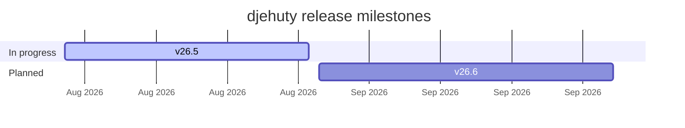

### 4TU.ResearchData

**Open research data infrastructure for science, engineering and design.**

[Website](https://data.4tu.nl) · [djehuty docs](https://djehuty.4tu.nl) · [Contributing](https://github.com/4TUResearchData/djehuty/blob/main/CONTRIBUTING.md) · [Code of conduct](https://github.com/4TUResearchData/djehuty/blob/main/CODE_OF_CONDUCT.md) · [djehuty Community](https://djehuty.4tu.nl/community/)

---

## What we build

| Project | What it is | |
|---|---|---|
| **[djehuty](https://github.com/4TUResearchData/djehuty)** | The repository system powering 4TU.ResearchData and Nikhef |  |
---

## Roadmap

Live progress on the next djehuty releases — full detail on the
**[milestones board →](https://github.com/4TUResearchData/djehuty/milestones)**

<!-- MILESTONES:START -->

<b>v26.9</b> &nbsp;·&nbsp; due 2026-10-20 &nbsp;·&nbsp; <code>█░░░░░░░░░</code> 11% &nbsp;·&nbsp; 1 of 9 done

- [ ] [#423](https://github.com/4TUResearchData/djehuty/issues/423) \[BUG\]: Help icons do not open on touch devices in the physical sample form
- [ ] [#399](https://github.com/4TUResearchData/djehuty/issues/399) \[BUG\]: Admin > Update Published Datesets > Licenses does not update Datacite metadata
- [ ] [#348](https://github.com/4TUResearchData/djehuty/issues/348) \[BUG\]: `insert_collection` writes the collection's `djht:datasets` list twice
- [x] [#341](https://github.com/4TUResearchData/djehuty/issues/341) \[DOCUMENTATION\\\]: Update `djehuty` documentation to reference the community website
- [ ] [#330](https://github.com/4TUResearchData/djehuty/issues/330) \[BUG\]: Notification banner and action bar are not pinned to the viewport in the physical sample form
- [ ] [#299](https://github.com/4TUResearchData/djehuty/issues/299) \[NEW FEATURE\]: admin > published datasets > retract | Enable retract all or multiple versions
- [ ] [#258](https://github.com/4TUResearchData/djehuty/issues/258) \[IMPROVEMENT\]: Make draft dataset deletion recoverable (soft delete)
- [ ] [#196](https://github.com/4TUResearchData/djehuty/issues/196) \[BUG\]: "Saved changes" notification shown in red when appended to an existing error notification
- [ ] [#146](https://github.com/4TUResearchData/djehuty/issues/146) \[IMPROVEMENT\]: Lint `src/djehuty/web/validator.py`

<b>v26.10</b> &nbsp;·&nbsp; due 2026-10-27 &nbsp;·&nbsp; <code>░░░░░░░░░░</code> 0% &nbsp;·&nbsp; 0 of 2 done

- [ ] [#374](https://github.com/4TUResearchData/djehuty/issues/374) \[BUG\]: Preview on a physical sample builds an invalid expiry date on the last day of a month
- [ ] [#285](https://github.com/4TUResearchData/djehuty/issues/285) \[BUG\]: the 'dataset search' option on the EDIT COLLECTION page doesn't work

<b>v26.11</b> &nbsp;·&nbsp; due 2026-11-03 &nbsp;·&nbsp; <code>░░░░░░░░░░</code> 0% &nbsp;·&nbsp; 0 of 1 done

- [ ] [#349](https://github.com/4TUResearchData/djehuty/issues/349) \[BUG\]: Collection editor drops the ORCID of a manually added author

<b>v26.12</b> &nbsp;·&nbsp; due 2026-11-10 &nbsp;·&nbsp; <code>░░░░░░░░░░</code> 0% &nbsp;·&nbsp; 0 of 2 done

- [ ] [#262](https://github.com/4TUResearchData/djehuty/issues/262) \[IMPROVEMENT\]: Rework usage statistics to avoid overloading Virtuoso
- [ ] [#153](https://github.com/4TUResearchData/djehuty/issues/153) \[BUG\]: search bar giving a GATEWAY TIMEOUT error on the first run

<!-- MILESTONES:END -->
<!--
  The table above is regenerated daily by .github/workflows/update-milestones.yml.
  Anything you type between the MILESTONES markers will be overwritten.
-->

---

## Getting involved

- **Report a bug or request a feature** — open an issue on the relevant repository.
- **Good first issues** — [browse them here](https://github.com/4TUResearchData/djehuty/issues?q=is%3Aopen+label%3A%22🌱+good+first+issue%22).
- **Security** — report vulnerabilities privately to <security@djehuty.4tu.nl>, not via a public issue. See our [security policy](https://github.com/4TUResearchData/djehuty/blob/main/SECURITY.md).
- **Governance** — how decisions get made is documented in [GOVERNANCE.md](https://github.com/4TUResearchData/djehuty/blob/main/GOVERNANCE.md).
- **Community hour** - Join our monthly community call. Find out more on the [djehuty Community](https://djehuty.4tu.nl/community/) webpage. 

4TU.ResearchData is a research infrastructure, community and training provider, led and governed by the four technical universities in the Netherlands.

